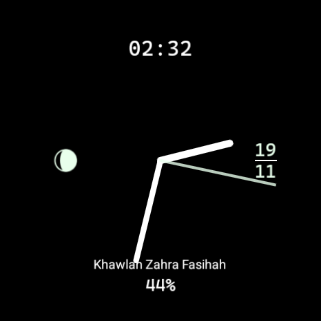

# Xiaomi Watch 2 toolkit

Utilities and a custom Watch Face Format project for the Xiaomi Watch 2.

<p align="center">
  
</p>

## Projects

| Directory | Description |
|---|---|
| [`watchface/`](watchface/) | **Black**, a minimal WFF v1 analog watch face with a pure-black background, white primary elements, and pale-mint accents. |
| [`debloat/`](debloat/) | Reversible ADB scripts for disabling optional packages on a Xiaomi Watch 2 without root. |

The projects were tested on a Xiaomi Watch 2 (`axolotlaxie`) running Wear OS 5
/ Android 14. Firmware and package names can differ by region and update.

## Quick start

### Watch face

Install JDK 17 or newer and Android SDK platform 36 with build-tools 37.0.0,
then configure your SDK in `watchface/local.properties`:

```properties
sdk.dir=/path/to/Android/Sdk
```

Validate, build, and install over ADB:

```bash
cd watchface
./tools/validate.sh
./tools/deploy.sh <watch-ip>:5555
```

See [`watchface/README.md`](watchface/README.md) for design, build, asset, and
release-signing details.

### Debloat scripts

> [!WARNING]
> The debloat list includes the Play Store, keyboard, TalkBack, Wallet/NFC,
> weather, and cell-broadcast packages. Disabling these can remove features,
> accessibility services, or emergency-alert functionality. Review the list
> before applying it.

```bash
cd debloat
./apply.sh --dry-run
./apply.sh
```

Every scripted change has a corresponding rollback command. Read
[`debloat/README.md`](debloat/README.md) before running either script.

## Releases

Generated APKs and signing keys are intentionally not stored in Git. Properly
signed installable builds can be attached to GitHub Releases. Local development
deployments use Android's debug signing key.

## Contributing

Repository conventions and verification commands are documented in
[`AGENTS.md`](AGENTS.md). Please keep debloat changes reversible and validate
the WFF document before submitting watch-face changes.

## License

The project source and scripts are licensed under the
[Apache License 2.0](LICENSE). Cascadia Code is bundled under the SIL Open Font
License 1.1; see
[`watchface/licenses/CascadiaCode-OFL.txt`](watchface/licenses/CascadiaCode-OFL.txt).
