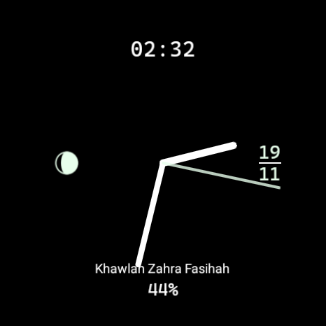

# Black — a minimal Wear OS watch face

**Black** is a resource-only analog watch face built with
[Watch Face Format](https://developer.android.com/training/wearables/wff)
**v1**. It has no application code, weather provider, complication slot, or
network dependency.

<p align="center">
  
</p>

## Design

- Pure-black background (`#FF000000`) with no indices or markers
- White vector hour/minute hands and a 20%-transparent pale-mint seconds hand
- No hand counterpoise
- Top-centre digital time in Cascadia Code
- Right-middle day/month stack separated by a white rule
- Left-middle phase-aware moon icon
- Bottom-centre battery percentage
- “Khawlah Zahra Fasihah” dedication in the system font
- Hands render above the moon icon
- System-controlled red notification indicator remains available

The face uses a 450×450 coordinate space and is tested on a 466×466 Xiaomi
Watch 2 (`axolotlaxie`) running Wear OS 5 / Android 14. Package ID:
`id.mustofa.wf.black`.

## Requirements

- JDK 17 or newer (JDK 21 is used in CI)
- Android SDK platform 36 and build-tools 37.0.0
- ADB for installation
- Python 3.10+ and `rsvg-convert` only when regenerating moon assets
- ImageMagick only when replacing the picker preview

Create an ignored `local.properties` file in this directory:

```properties
sdk.dir=/path/to/Android/Sdk
```

## Validate, build, and install

Validate the WFF document against the official schema:

```bash
./tools/validate.sh
```

Build and install a debug-signed development APK on an already connected watch:

```bash
./tools/deploy.sh
```

Or let the script connect to a wireless-debugging address:

```bash
./tools/deploy.sh <watch-ip>:5555
```

The script runs `:face:assembleDebug` and then `adb install -r`, so reinstalls
retain the package identity and usually keep the face selected. To select it for
the first time, long-press the current face and choose **Black** in the picker.

Build every local variant directly with Gradle:

```bash
./gradlew :face:assembleDebug :face:assembleRelease
```

Without private signing properties, the release output is intentionally
unsigned. Debug builds use Android's normal local debug key.

## Release signing

Release keys and passwords must never be committed. To configure a signed
release build:

1. Copy `keystore.properties.example` to `keystore.properties`.
2. Create or select a private keystore outside the repository.
3. Fill in `storeFile`, `storePassword`, `keyAlias`, and `keyPassword`.
4. Run `./gradlew :face:assembleRelease`.
5. Verify the result with `apksigner verify --verbose <apk>`.

Both `keystore.properties` and common keystore extensions are ignored by Git.
Publish signed APKs through GitHub Releases rather than committing them to the
source tree. Android cannot update a debug-signed installation with a different
release certificate; uninstall the debug build once before installing the first
production-signed build.

## Editing

Most visual structure lives in `face/src/main/res/raw/watchface.xml`.

| Element | Source |
|---|---|
| Hand shape/color | `face/src/main/res/drawable/hand_*.xml` |
| Hand placement/length | `AnalogClock` in `watchface.xml` |
| Moon phases | `face/src/main/res/drawable-nodpi/moon_*.png` |
| Date rule | `face/src/main/res/drawable-nodpi/date_separator.png` |
| Text content/position | `PartText` and `TimeText` in `watchface.xml` |
| Cascadia Code | `face/src/main/res/font/cascadia_code.ttf` |
| Picker preview | `face/src/main/res/drawable/preview.png` |

### Generated moon assets

The moon shapes are generated from circle and terminator-ellipse geometry. WFF
`PartImage` silently skips VectorDrawable resources on the tested runtime, so
the icons are 40 px density-neutral PNGs sized close to their ~37 px rendered
size:

```bash
python3 tools/make-moon-icons.py
```

This also regenerates the date separator. The moon `Condition` intentionally
appears before `AnalogClock` in document order so the hands paint above it.

### Screenshot-based picker preview

The committed preview is a clean on-device screenshot, which accurately
captures Wear OS font rendering and antialiasing. Capture and inspect a frame,
then normalize it as the preview:

```bash
./tools/screenshot.sh
./tools/make-preview.sh screenshots/watchface-YYYYMMDD-HHMMSS.png
```

Use an active-mode frame without a PIN screen, AOD dimming, notification dot,
transition frame, or right-edge ghosting. `make-preview.sh` accepts a square
image and normalizes it to 466×466 sRGB PNG.

## Current palette

| Element | ARGB |
|---|---|
| Background | `#FF000000` |
| Hour/minute hands | `#FFFFFFFF` |
| Seconds hand before element alpha | `#FFE8FFEC` |
| Moon and date numbers | `#FFE8FFEC` |
| Date rule | `#FFFFFFFF` |
| Time, battery, and dedication | `#FFFFFFFF` |

Ambient mode dims the primary elements and hides the seconds hand.

## Troubleshooting

- **ADB is offline:** wake the watch, run `adb mdns services`, then reconnect.
- **Face is missing:** verify `adb shell pm list packages | grep id.mustofa.wf.black`
  and inspect `adb logcat | grep -i watchface`.
- **Moon is missing:** inspect `adb logcat | grep ModelMoonPhase`; the default
  branch should draw a plain ring when moon phase data is unavailable.
- **Picker still shows an old preview:** reinstall the package and reopen the
  picker; Wear OS can cache thumbnails briefly.
- **Release APK is unsigned:** configure the ignored `keystore.properties`, or
  use `tools/deploy.sh` for a debug-signed development install.

## License

Project source is licensed under Apache-2.0; see [`../LICENSE`](../LICENSE).
Cascadia Code remains under the SIL Open Font License 1.1; see
[`licenses/CascadiaCode-OFL.txt`](licenses/CascadiaCode-OFL.txt).
